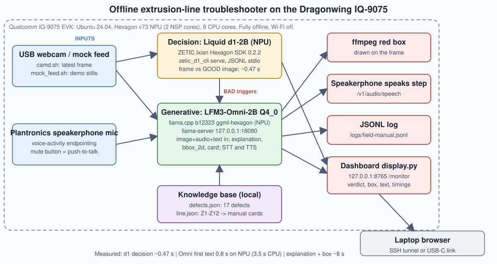
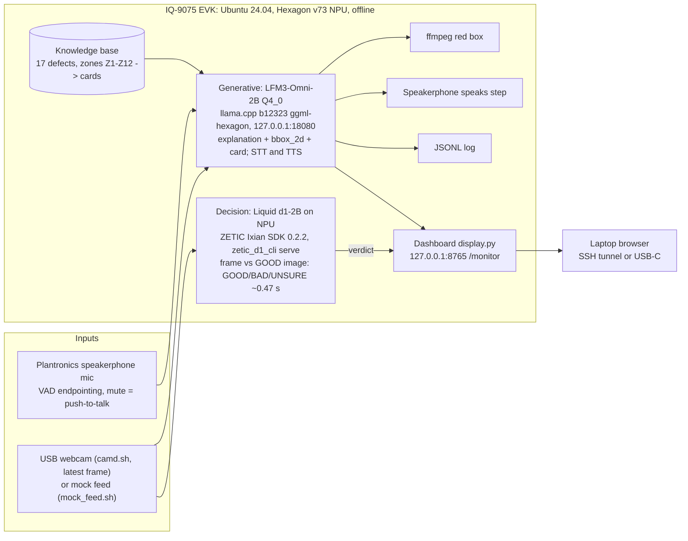

# Architecture

Offline troubleshooting assistant for a polycarbonate sheet extrusion line, running entirely on a Qualcomm Dragonwing IQ-9075 EVK (Wi-Fi off). Image for Arduino Project Hub: [`architecture.svg`](architecture.svg).

| # | Component | Role |
|---|---|---|
| 1 | IQ-9075 EVK | Ubuntu 24.04, Hexagon v73 NPU (two NSP cores), 8 CPU cores; fully offline, Wi-Fi off |
| 2 | USB webcam / mock feed | camd.sh keeps the latest frame; mock_feed.sh serves demo stills of the line |
| 3 | Speakerphone mic | Plantronics; voice-activity endpointing, mute button = push-to-talk |
| 4 | d1-2B decision model | Liquid model on NPU via ZETIC Ixian 0.2.2 (`zetic_d1_cli serve`, JSONL stdio); live frame vs GOOD image gives GOOD/BAD/UNSURE in ~0.47 s |
| 5 | LFM3-Omni-2B | Q4_0 GGUF on NPU, llama.cpp b12323 ggml-hexagon, patched v73 HTP library; image+audio+text in |
| 6 | llama-server | OpenAI-compatible API on 127.0.0.1:18080, incl. /v1/audio/speech for TTS |
| 7 | Knowledge base | kb/defects.json (17 defects) + kb/line.json (Z1-Z12) compiled to cards; answer must cite a real card or says it cannot match |
| 8 | ffmpeg | Draws the red box (bbox_2d, 0-1000) on the frame |
| 9 | Speaker output + JSONL log | Speakerphone speaks the step; logs/field-manual.jsonl records each run |
| 10 | Dashboard display.py | 127.0.0.1:8765, /monitor (Monitor/Analyze/Reset); control image, live input, verdict, box, text, timings; viewed from laptop via SSH tunnel or USB-C |

Measured: d1 decision ~0.47 s; Omni image+question first text 0.8 s on NPU (3.5 s on CPU); inspection explanation + box ~8 s.
