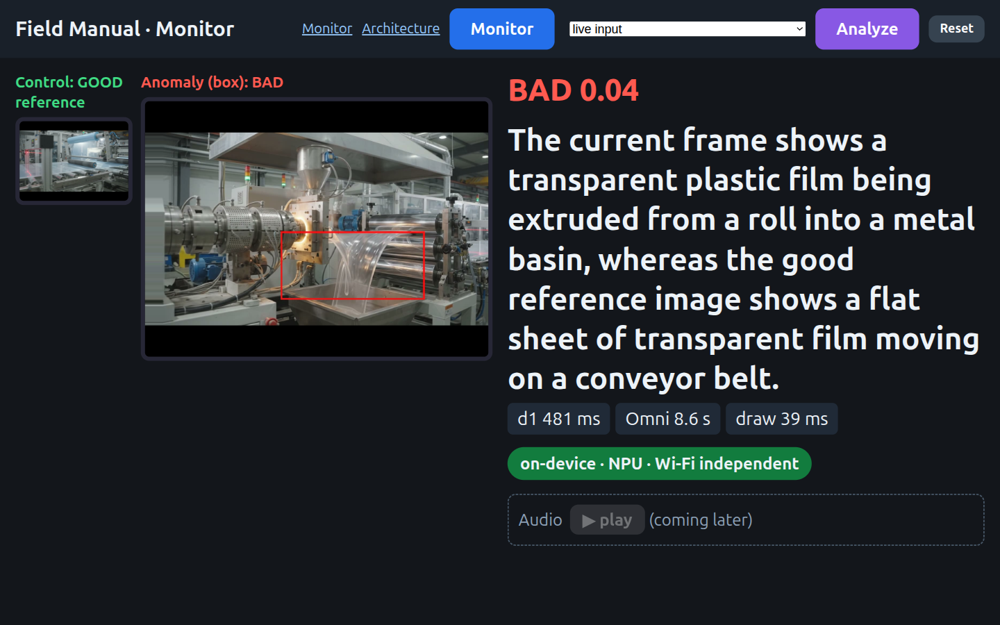
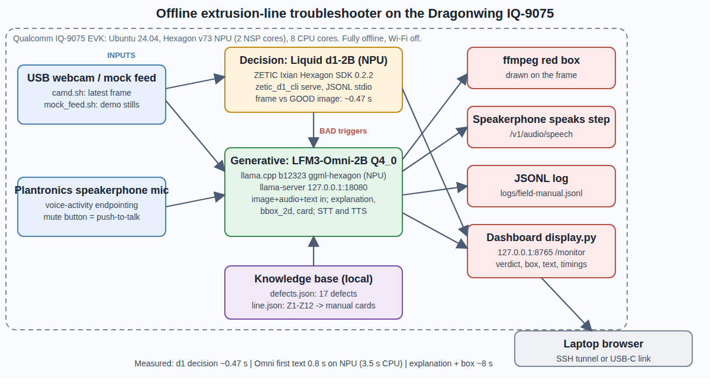

# PC Line Assist

**An offline AI assistant that helps an operator find and fix failures on a polycarbonate sheet extrusion line, fast.**

When a defect appears on the sheet, the operator takes a photo. The assistant names the defect, shows which part of the line causes it, and gives numbered fix steps taken from the line's own knowledge base. Line sensors add a second layer: they catch some machine failures before any defect reaches the sheet. Everything runs on a Qualcomm device next to the machine, with no cloud connection.

## Contributors

| GitHub | Contribution |
|---|---|
| [ambrogian](https://github.com/ambrogian) | Line knowledge base, failure scenarios, showcase, sensor-alert demo, demo videos |
| [contrapuntal](https://github.com/contrapuntal) | IQ-9075 board runtime: d1 and LFM3-Omni on the NPU, inspection and voice field manual, dashboard |
| [Vent3st](https://github.com/Vent3st) | IQ-9075 inspection demo mocks and d1 decision service ([#1](https://github.com/ambrogian/hackathon/pull/1)) |

## Branches

| Branch | What it holds |
|---|---|
| [`main`](https://github.com/ambrogian/hackathon/tree/main) | The knowledge base, the assistant showcase, the four sensor-failure scenarios, the sensor-alert demo, the line visuals and the pitch. Everything runs in a browser with no install. |
| [`feat/field-manual-iq9`](https://github.com/ambrogian/hackathon/tree/feat/field-manual-iq9) ([PR #2](https://github.com/ambrogian/hackathon/pull/2)) | The on-device runtime on the Qualcomm Dragonwing IQ-9075 (`field-manual/`): d1-2B and LFM3-Omni-2B on the Hexagon NPU, visual inspection against a GOOD control image, voice push-to-talk answers from the knowledge base, and the Monitor dashboard. Also adds the 17th defect (melt dumping / sheet not threaded) and the demo images. |
| [`add-iq9-mocks`](https://github.com/ambrogian/hackathon/tree/add-iq9-mocks) ([PR #1](https://github.com/ambrogian/hackathon/pull/1)) | Mock screens for the full product (an extrusion fault with a d1 second opinion, and "ask the plant" with code-checked tool calls), console captures, and a d1 decision service with the four extrusion scenarios. Its numbers come from a laptop CPU. |

## Why it matters

- A sheet line runs around the clock at more than a tonne of sheet per hour (1,180 kg/h in our example). It keeps running while the cause of a defect is found, so every minute of searching becomes scrap.
- The cause is often far from where the defect shows up. Bubbles appear at the end of the line, but they often come from wet resin in the dryer, at the other end of the line. Experienced operators know this; new ones and night shifts often don't.
- Saving 30 minutes on one incident saves about 590 kg of polycarbonate.

## See it in 2 minutes

No install and no internet needed. Clone or download the repo, then open these files in a browser:

| Open | What you see |
|---|---|
| `showcase/index.html` | **The assistant.** A diagram of the full line in 12 zones. Pick a defect and press **Play the scenario**: Spot → Diagnose → Fix → Resume, with the responsible machine part highlighted. |
| `demo/index.html` | **Sensor alerts.** A line video that pauses at four machine failures. Each alert shows the sensor signal, the part to repair and how to restart. (`demo/line.mp4` must stay next to it.) |
| `visuals/pc-extrusion-line.html` | **The machine.** Illustrated plant layout and what happens inside each section. |
| `docs/KNOWLEDGE_BASE.md` | **The knowledge.** All 17 defects: what they look like, where they start, fix steps, when to escalate. |

## How it works

```
Photo of the sheet ──► vision model on the device ──► defect id (one of 17)
                                                         │
Line sensors ──► detection rules ──► failing part         │
                                                         ▼
                              knowledge base (kb/): zone, fix steps, safety rule
                                                         │
                                                         ▼
                              operator screen: where to look, what to do
```

The model only decides *what* it sees. The steps it shows always come word for word from the knowledge base, so it can't invent an unsafe procedure. Details: [`docs/ARCHITECTURE.md`](docs/ARCHITECTURE.md).

## Running on the IQ-9075 (`field-manual/`)



d1-2B on the NPU compares the camera frame with the GOOD control image (481 ms). On BAD, LFM3-Omni-2B on the NPU
explains the fault and boxes it (8.6 s), and ffmpeg draws the box (39 ms). All of it runs on the board with Wi-Fi off.
The same board also answers spoken questions through a speakerphone with one step from the knowledge base.
The line images are stills from the AI-generated demo videos in `media/`, not a real plant.



Details: [`docs/ARCHITECTURE-IQ9.md`](docs/ARCHITECTURE-IQ9.md), [`field-manual/README.md`](field-manual/README.md),
[`field-manual/OVERVIEW.md`](field-manual/OVERVIEW.md) (measured numbers).

## What's in the repo

| Folder | Contents |
|---|---|
| `kb/` | Knowledge base: `line.json` (12 zones, safety rules, triage by visual pattern), `defects.json` (17 defects), `system_prompt.md` (prompt for the on-device model), `build.py` (validates the knowledge base and generates the pages and docs) |
| `showcase/` | The assistant demo page. `template.html` is the source; `index.html` is generated with the knowledge base built in |
| `scenarios/` | Four machine failures (dryer heater, torn screen, die heater, roll drive) with simulated sensor data, detection rules and repair playbooks. See [`scenarios/README.md`](scenarios/README.md) |
| `demo/` | The sensor-alert demo page and its video |
| `visuals/` | Illustrated line overview |
| `media/` | Video clips used in the pitch |
| `field-manual/` | The IQ-9075 runtime: inspection (`inspect_mode.py`), voice field manual (`field_manual.py`), dashboard (`display.py`), camera and mock feeds, demo images |
| `docs/` | Knowledge base (readable), architecture, pitch run of show |

## Status: what's real and what's simulated

| Part | Status |
|---|---|
| Knowledge base: 17 defects, 12 zones, safety rules | Built and validated by `kb/build.py` |
| Sensor detection rules | Built. They run on **simulated** sensor data; `python3 scenarios/diagnose.py` checks all four scenarios |
| Assistant interface | Built. Diagnoses on the page are **scripted** from the knowledge base |
| On-device models | Running on the IQ-9075 NPU in `field-manual/`: d1-2B verdict in about 0.5 s, LFM3-Omni-2B explanation and box in about 8.6 s, Omni first text 0.8 s. The showcase page itself is still scripted |

## Run the scripts

Python 3 only, no packages needed.

```bash
python3 kb/build.py            # validate the knowledge base, rebuild showcase/index.html and docs/KNOWLEDGE_BASE.md
python3 scenarios/simulate.py  # regenerate the simulated sensor data
python3 scenarios/diagnose.py  # run the detection rules on all four scenarios (self-check included)
python3 demo/build_demo.py     # rebuild demo/index.html from the detector output
```

## Notes

- The videos in `media/` and `demo/` are AI-generated illustrations, not footage of a real line.
- The knowledge base reflects general polycarbonate sheet extrusion practice. Setpoints, part names and steps must be confirmed by the plant's process engineer before use on a real line.
- Sensor tag names, roll sizes and repair times in `scenarios/` are illustrative.
- Sample defect photos in the assistant page are generated drawings.
